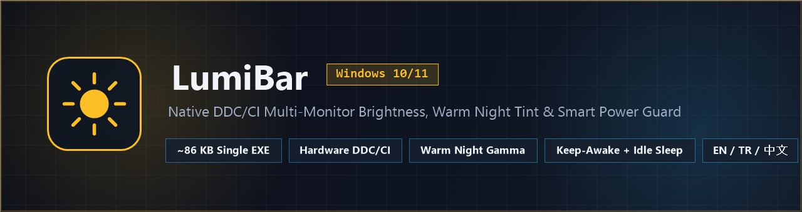
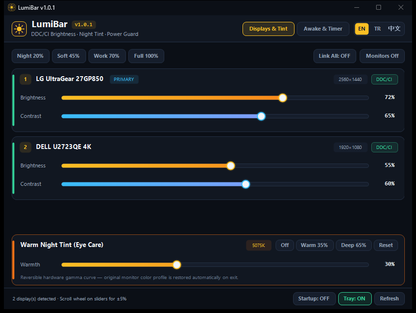
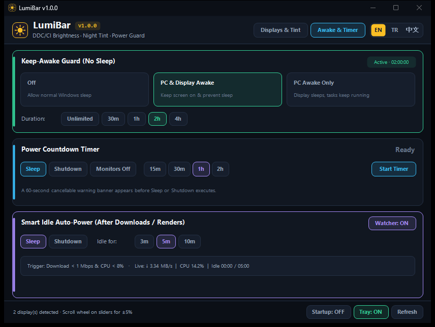

<p align="center">
  
</p>

<p align="center">
  <strong>English</strong> | <a href="README.zh-CN.md">简体中文</a>
</p>

<p align="center">
  <a href="https://github.com/rodvay/LumiBar/releases/latest"></a>
  
  
  
  <a href="LICENSE"></a>
</p>

---

**LumiBar** is an ultra-lightweight (**~86 KB**), single-file native Windows 10/11 desktop monitor controller & power guard. It replaces heavy ~150 MB Electron brightness trays (like Twinkle Tray), Caffeine utilities, and shutdown timers with a single zero-bloat native executable.

## Screenshots

<p align="center">
  
  
</p>

## Key Features

- **Native Hardware DDC/CI Brightness & Contrast (`dxva2.dll`):** Controls real physical monitor backlight & contrast over DisplayPort / HDMI / USB-C via a coalesced non-blocking worker thread (zero slider lag!).
- **Automatic EDID Model Detection + Smart Fallbacks:** Displays exact monitor brand & model names via `WmiMonitorID` EDID (`Acer KG241Q S`, `ASUS VG245`, `LG UltraGear`, etc.), falls back seamlessly to **Laptop WMI (`WmiMonitorBrightnessMethods`)** for built-in panels, or safe **Software Gamma** (`20%–100%` floor) if a display disables DDC/CI.
- **1-Click Presets, Multi-Monitor Sync & Monitors Off:** Instant `Night 20%`, `Soft 45%`, `Work 70%`, `Full 100%` presets, **Link All** multi-monitor sync toggle, mouse-wheel `±5%` micro-stepping on any slider, and 1-click **Turn Off Monitors**.
- **Reversible Warm Night Tint (`6500K → 2700K`):** Smooth hardware gamma eye-care slider (`SetDeviceGammaRamp`) that snapshots your exact original monitor gamma on startup and **automatically restores it on exit** (or on 1-click Reset).
- **Native Keep-Awake Guard (`SetThreadExecutionState`):** Keep **PC & Display Awake** or **PC Awake Only (Display Sleeps)** for `Unlimited`, `30m`, `1h`, `2h`, or `4h` — zero synthetic keypress hacks.
- **Countdown Timer & Smart Idle Auto-Sleep/Shutdown:** Schedule Sleep, Shutdown, or Monitors Off — OR enable **Smart Idle Auto-Power** to automatically sleep/shut down once **Download < 1 Mbps & CPU < 8%** continuously for `3 / 5 / 10 min` (perfect for overnight downloads & renders!). Always shows a **60-second cancellable warning banner** before acting.
- **Trilingual Native UI (`EN / TR / 简体中文`):** Auto-detects Windows UI language, dark title bar, Per-Monitor V2 DPI, optional Start with Windows, System Tray quick presets & Single-Instance Mutex.

## Download & Run

1. Grab **`LumiBar.exe`** from [GitHub Releases](https://github.com/rodvay/LumiBar/releases/latest).
2. Double-click to run — **no admin privileges required**, 100% portable.
3. *(Tip)* Make sure **DDC/CI** is enabled in your desktop monitor's physical OSD menu for direct hardware brightness & contrast control.

### Build from Source (Zero External SDK Required)

```powershell
.\build.ps1
```

## Türkçe Özet

**LumiBar**, Windows 10/11 için yalnızca **~86 KB** boyutunda, kurulumsuz, tek dosya yerel **Çoklu Monitör DDC/CI Parlaklık, Sıcak Gece Tonu ve Akıllı Güç Koruma** aracıdır:
- 150 MB'lık Electron parlaklık araçları yerine doğrudan Windows `dxva2.dll` (DDC/CI) + Laptop WMI üzerinden donanımsal parlaklık ve kontrast kontrolü sunar; monitör marka/modelini EDID'den otomatik okur.
- Göz yorgunluğunu azaltan **Sıcak Gece Tonu (`6500K → 2700K`)** uygulamadan çıkıldığında orijinal gamma profilini otomatik geri yükler.
- **Uyanık Tut (Keep-Awake)**, **Geri Sayım Zamanlayıcısı** ve indirme/render bitince (`İndirme < 1 Mbps & CPU < %8`) 60 saniyelik iptal edilebilir uyarıyla otomatik uyutan/kapatan **Akıllı Boşta Güç** modülünü içerir.

## Part of the Zero-Bloat Windows Suite

Check out the full native open-source collection on [**@rodvay**](https://github.com/rodvay):
- [**PCUptime**](https://github.com/rodvay/PCUptime) · [**SafeSweep**](https://github.com/rodvay/SafeSweep) · [**WinForge**](https://github.com/rodvay/WinForge) · [**CorePulse**](https://github.com/rodvay/CorePulse) · [**PortWatch**](https://github.com/rodvay/PortWatch) · [**LumiBar**](https://github.com/rodvay/LumiBar)

## License

[MIT License](LICENSE) © 2026 [rodvay](https://github.com/rodvay)
