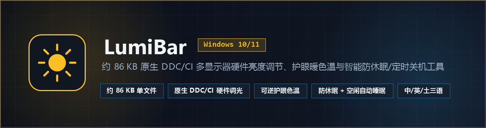
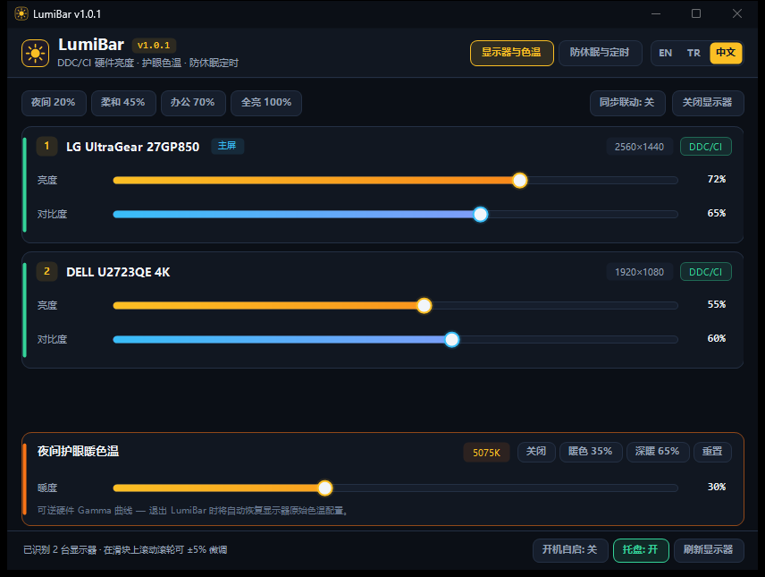
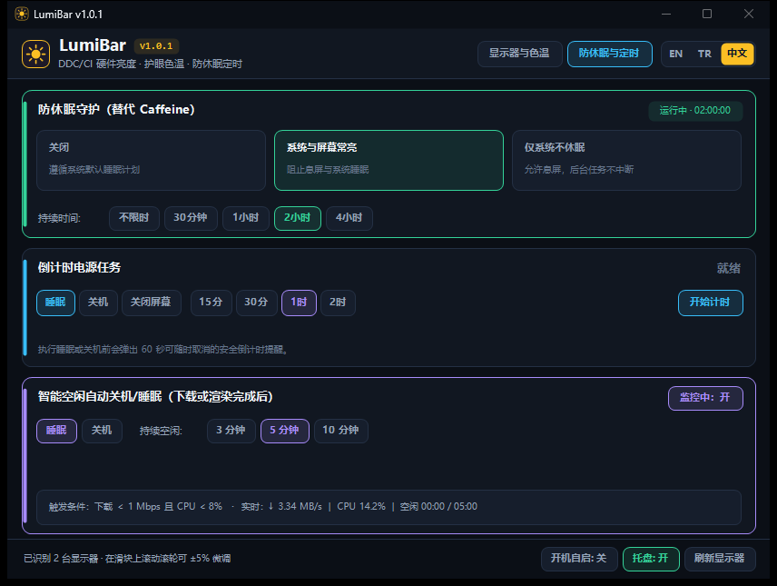

<p align="center">
  
</p>

<p align="center">
  <a href="README.md">English</a> | <strong>简体中文</strong>
</p>

<p align="center">
  <a href="https://github.com/rodvay/LumiBar/releases/latest"></a>
  
  
  
  <a href="LICENSE"></a>
  <a href="https://linux.do"></a>
</p>

---

**LumiBar** 是一款仅 **~86 KB** 的原生单文件 Windows 10/11 多显示器硬件调光与电源守护工具。用一个极简原生 EXE 同时替代上百 MB 的 Electron 亮度托盘（如 Twinkle Tray）、防休眠工具（Caffeine）与定时关机工具！

## 界面预览

<p align="center">
  
  
</p>

## 核心特性

- **原生硬件 DDC/CI 亮度与对比度 (`dxva2.dll`)：** 通过 DisplayPort / HDMI / USB-C 直接调节台式机外接显示器的真实背光与对比度；后台合并写入队列确保拖动滑块丝滑零卡顿。
- **自动读取真实 EDID 型号 + 智能回退：** 自动从 `WmiMonitorID` 识别真实显示器品牌与型号；笔记本内置屏自动走 **WMI 硬件调光**；未开启 DDC/CI 的显示器自动回退至安全的 **软件 Gamma 调光**（保留最低 20% 保护下限，永不黑屏）。
- **一键预设、多屏联动与一键息屏：** 内置 `夜间 20% / 柔和 45% / 办公 70% / 全亮 100%` 快捷预设、多显示器同步联动开关、滑块滚轮 `±5%` 微调，以及一键关闭所有显示器。
- **可逆夜间护眼暖色温 (`6500K → 2700K`)：** 启动时备份每台显示器原始 Gamma 曲线，退出程序或点击「重置」时**自动无损还原**原始色温。
- **原生防休眠守护 (`SetThreadExecutionState`)：** 支持「系统与屏幕常亮」或「仅系统不休眠（允许息屏）」，可选不限时 / 30 分钟 / 1 / 2 / 4 小时，不模拟按键、不干扰输入。
- **倒计时电源任务 & 智能空闲自动睡眠/关机：** 支持固定倒计时，也可开启**智能空闲监控** —— 当实时**下载速率 < 1 Mbps 且 CPU < 8%** 持续达 3 / 5 / 10 分钟（挂机下载或渲染完成后）自动执行睡眠或关机；执行前必弹 **60 秒可随时取消的安全倒计时提醒**。
- **三语原生界面与托盘快捷操作：** 内置 **简体中文 / English / Türkçe**（自动识别系统语言）、Per-Monitor V2 高分屏适配、可选开机自启、系统托盘快速调光与单实例防多开。

## 下载与使用

1. 前往 [GitHub Releases](https://github.com/rodvay/LumiBar/releases/latest) 下载 **`LumiBar.exe`**。
2. 无需管理员权限，绿色免安装，双击即可使用。
3. *提示：外接显示器需在显示器物理 OSD 菜单中保持 `DDC/CI` 开启，即可直接进行硬件级亮度与对比度调节。*

### 本地零依赖编译

```powershell
.\build.ps1
```

## 原生零臃肿 Windows 工具全家桶

欢迎访问 [**@rodvay**](https://github.com/rodvay) 查看同系列全部开源免费工具：
- [**PCUptime**](https://github.com/rodvay/PCUptime) · [**SafeSweep**](https://github.com/rodvay/SafeSweep) · [**WinForge**](https://github.com/rodvay/WinForge) · [**CorePulse**](https://github.com/rodvay/CorePulse) · [**PortWatch**](https://github.com/rodvay/PortWatch) · [**LumiBar**](https://github.com/rodvay/LumiBar)

## 社区与友情链接

- 感谢 **[LINUX DO](https://linux.do)** 社区的开源分享氛围与各位佬友的支持与反馈！

## 开源协议

[MIT License](LICENSE) © 2026 [rodvay](https://github.com/rodvay)
